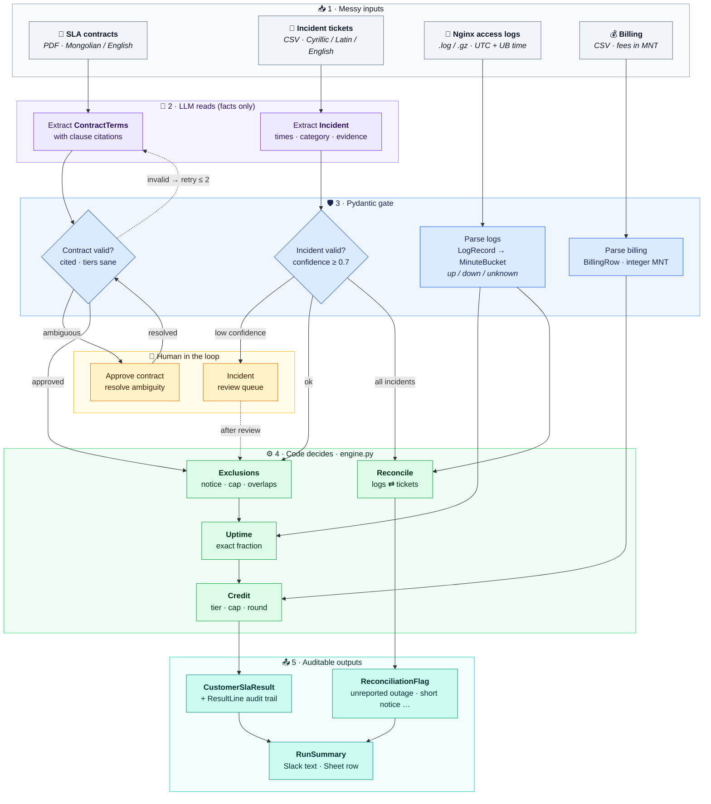

# SLA Credit Calculator

Every month, someone counts downtime minutes by hand, subtracts planned maintenance, re-reads each contract
to find the credit tier, and works out the amount in Excel. Credits often go unclaimed, or get disputed
because nobody has evidence. This tool answers one question for an account manager or SRE lead:

> **Which customers are owed how much credit this month, and why?**

It takes messy inputs (Nginx logs, multilingual tickets, PDF contracts, a billing CSV) and produces a
per-customer result. Every credit figure in that result can be traced back to minute ranges, ticket IDs and
contract clauses.



| Colour | Stage | Rule it enforces |
|---|---|---|
| 🟪 Purple | LLM reads | Extracts facts and citations only, never numbers or decisions |
| 🟦 Blue | Pydantic gate | Nothing reaches the engine without passing a model |
| 🟨 Amber | Human in the loop | Ambiguous contracts and low-confidence incidents wait for a person |
| 🟩 Green | Code decides | All time, exclusion and money logic is deterministic and unit-tested |
| 🟦 Teal | Outputs | Every credit traces back to minutes, ticket IDs and contract clauses |

## Quick start

```bash
uv sync            # or: pip install -e . pytest
uv run pytest      # 8 test files, 111 cases, ~2 s, no network
```

## Layout

| Path | What it holds |
|---|---|
| `src/sla_credit/models/inputs.py` | **Input formats**: `LogRecord`, `MinuteBucket`, `ProbeResult`, `RawTicket`, `BillingRow`, plus the LLM output contracts `Incident` and `ContractTerms` |
| `src/sla_credit/models/outputs.py` | **Output formats**: `ResultLine`, `CustomerSlaResult`, `ReconciliationFlag`, `RunSummary` (with Slack text) |
| `src/sla_credit/ingest.py` | Streaming parsers for logs (`.log`/`.gz`), tickets CSV and billing CSV |
| `src/sla_credit/engine.py` | Pure deterministic logic: buckets, exclusions, uptime, credit, reconciliation |
| `tests/test_*.py` | 8 test files covering messy and unusual cases (see below) |
| `tests/fixtures/` | Synthetic messy inputs and recorded LLM outputs. No real customer data. |

---

## Design decisions (one page)

**1. The LLM reads, the code decides.** The LLM only fills `ContractTerms` (from PDFs) and `Incident` (from
tickets). Both models use `extra="forbid"`, so if the LLM sends back `duration_minutes` or
`credit_amount_mnt`, validation fails; tests check exactly this. Uptime, durations, exclusion eligibility,
tier lookup, caps and money are all computed in `engine.py`, which has no I/O, no clock and no network.

**2. Pydantic models are the contract at every boundary.** Each input crosses exactly one model before code
uses it, and each output is built through a model. The models check meaning as well as types:

- **Contracts:** tiers cannot overlap or leave gaps, they must cover `[0, target)`, and the credit % cannot
  go down as uptime goes down. Every value needs a citation. A null field must be listed in `ambiguities`.
- **Incidents:** `end > start`, and times must carry a timezone offset. An optional plausibility check
  (`context={"ticket_created_at": ...}`) catches a relative time such as "өчигдөр" (yesterday) that was
  resolved to the wrong year.
- **Results:** the numbers must add up. Excluded, down and unknown line minutes must equal the header
  totals, `measured = total − excluded`, and the credit must fall within its best/worst range. If the
  engine has a bug, the result fails to build instead of being sent out.

**3. Ambiguity blocks the calculation; the system never guesses.** A vague clause such as "reasonable
notice" becomes `null` plus an `Ambiguity(field, quote, clause)` entry. `ContractTerms.is_calculable` is then
false, and the engine raises `ContractNotCalculable` until a person resolves it.

**4. Exact numbers.** Percentages are `Decimal`, so `99.9` stays exactly 99.9 and never becomes
99.90000000000000568. Uptime is a `Fraction`, and tier lookup compares exact fractions. Money is `int` MNT.
`BillingRow` accepts `"12,500,000₮"`, `"4 800 000 MNT"` and `"2 000 000 төг"`, but rejects `1250000.50`,
floats and booleans.

**5. Rules that are written down and tested:**

| Rule | Decision |
|---|---|
| Tier bands | Half-open `[min, max)`. Uptime ≥ target earns 0%. Tested at exactly 99.9, 99.0 and 95.0. |
| Rounding | Round half up to whole MNT, once, at the last step. Displayed uptime is *truncated* to 4 decimal places, so 99.8999 is never shown as 99.9. |
| Partial minutes | An incident excludes only minutes it fully covers. This favours the customer. |
| Overlaps | Each minute can be excluded at most once. The earliest incident owns it. Overlap does not use up the maintenance cap. |
| Month boundary | The month window is built in the **contract** timezone; all internal times are UTC. |
| Notice | `start − notified_at < min_notice_hours` (or no notice at all) → not excluded, and flagged. Exactly 72 h is enough. |
| Maintenance cap | Minutes over `max_hours_per_month` count normally, and the incident is flagged. |
| Low confidence | `confidence < 0.7` → review queue. The incident is never applied automatically. |

**6. Missing logs are not the same as no traffic.** A silent minute in an hour that normally has ≥ 1
request per minute is marked `unknown`, not `up`, because Nginx logs nothing while it is down itself. Probe
data, if present, decides those minutes. Unknown minutes are left out of the headline figure, and the
result also reports a **best case** (unknown counted as up) and a **worst case** (unknown counted as down).
Buckets that are missing entirely are also treated as unknown.

**7. Bad input is counted, never silently dropped.** The log parser reports `unparseable` plus up to 20
sample lines, and sets `truncated` when a rotated `.gz` file was cut off mid-write. A bad ticket row is
rejected with its row number and reason. A bad or duplicate billing row stops the whole run, because a
wrong fee means a wrong credit.

**8. Reconciliation turns disagreements into findings.** The four flag types are: outage in the logs with no
ticket, ticket with no outage in the logs, maintenance announced with too little notice, and maintenance
cap exceeded. The demo moment: a 20-minute outage on 25 October that nobody filed a ticket for is caught
anyway.

**Trade-offs and what is not built yet.** Only 1-minute error-rate windows are supported; anything else
raises `NotImplementedError` rather than calculating a wrong answer. The hour-of-day baseline is simple: it
does not distinguish weekdays from weekends. The LLM client, Langfuse tracing, database, Google Sheets and
Slack posting are specified in `CLAUDE.md` but not built here. The models above are the interfaces those
parts will fill.

---

## Test files: messy and unusual cases

| File | Messy cases |
|---|---|
| `test_nginx_parser.py` | Two log formats; `+0800`, `+0000`, `Z`, missing offsets and naive timestamps; lines cut off mid-write; `31/Sep`; status `999`; `Okt`; HTML in the log; IPv6; `"-"` as the request line; CRLF line endings; invalid UTF-8; `.gz` files, including a truncated one |
| `test_minute_buckets.py` | Error-rate threshold exactly at 5%; 4xx errors not counted; silent minutes during a busy hour vs a quiet hour; probes deciding unknown minutes; a probe-based contract; December → January year change; leap-year February; a DST month |
| `test_tickets_and_incidents.py` | BOM and padded headers; multi-line cells; embedded quotes; Cyrillic, transliterated Mongolian, English and emoji; rows missing an ID or with a free-text date; "yesterday" resolved to the wrong year; LLM output with no offset, an extra computed field, or an unknown category |
| `test_contract_terms.py` | Tiers in an annex listed out of order; numbers returned as strings; a vague "reasonable notice" clause; a null field with no ambiguity listed; a missing citation; tiers that overlap, leave a gap, or pay less credit as uptime falls; `UTC+8` given as a timezone; the LLM computing money |
| `test_billing.py` | `₮` before or after the number, `MNT`, `төг`; NBSP, apostrophe and underscore separators; `.00` vs `.50`; zero or negative fees; `TBD`; `1.5M`; duplicate customers differing only in case; blank rows |
| `test_exclusions.py` | Overlapping incidents; 16.8 h notice when 72 h is required; no notice; exactly 72 h; cap exceeded; force majeure overlapping maintenance; an incident crossing into November; low confidence plus odd service-name casing; partial minutes; categories the contract does not list |
| `test_credit.py` | Exact boundaries at 99.9, 99.0 and 95.0; 44 vs 45 down minutes; display truncation; cap below the tier; rounding half up; best/worst range for unknown minutes; missing buckets; a whole month excluded (no division by zero); an ambiguous contract that is refused |
| `test_outputs_and_reconcile.py` | A synthetic month run end to end through the engine; the reconciliation flags (the cap-exceeded flag is tested in `test_exclusions.py`); every line traced to its ticket and clause; JSON round trip; results whose numbers do not add up are rejected; a duplicate Sheet row; the wrong month |
